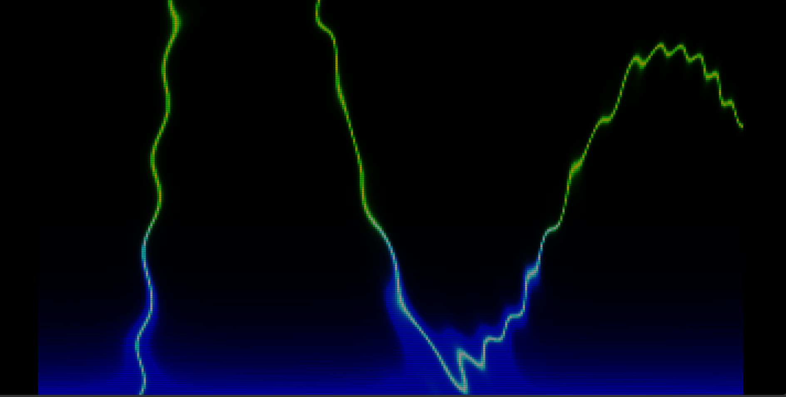

# shrunk-hyperbola 
its a per cell shader made on a 2d canvas. for each 60000 cells it computes a math function, and paints them. same as a gpu fragment shader, done by the cpu tho.

## HOW IT WORKS
it calculates the field which has alot of different functions primarily hyperbolic functions then it calculates d=40/(field*field) so wherever the field functions approaches to zero the d approaches inifinity and paints that particular cell making it look like the way it is. the bottom rows are painted first and the top rows are painted over them,this matters because the cells overlap and are semi transparent. I also added a mouse ripple/warp effect.

1. Math.sin(a*a - b*b)
gives hyperbolic ripple bands.

2. (a*b + Math.cos(a - time) * 20) 
another hyperbola family. and the cos term is a wave travelling along x its what drives the motion forward.

3. sin(4*b) 
gives the horizontal stripes.